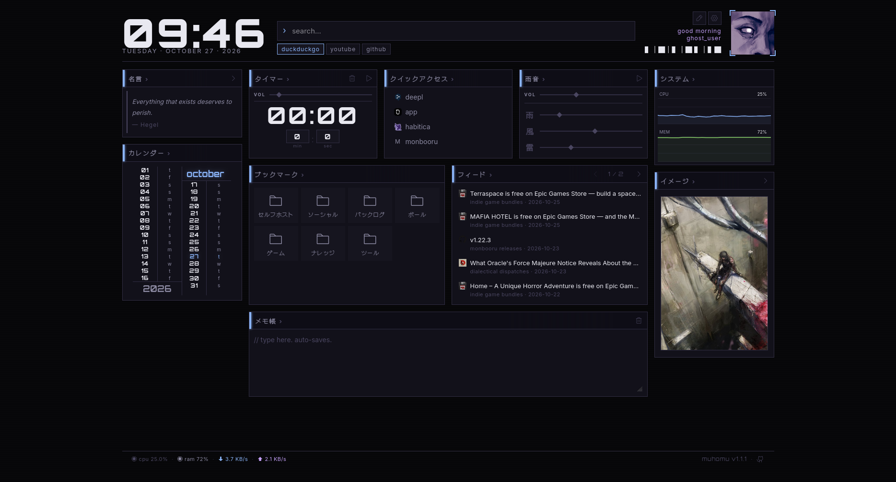

<div align="center">
  <h1>無ホム · muhomu</h1>
  <p><em>A self-hosted new-tab dashboard. The blank page, made yours.</em></p>
</div>

---



---

## What is this?

muhomu (無ホム — *mu* "nothing" + *homu* "home") is a single-binary dashboard that replaces your browser's new-tab page. Instead of a blank slate, you get your bookmarks, feeds, notes, and system stats arranged in a page that looks the way you want it to.

It is server-rendered Go + [htmx](https://htmx.org/): every widget is an independent, server-rendered unit, and the page is just a composition of them. There is no frontend framework — the browser receives HTML, and htmx swaps in new HTML as you interact. Your content lives in a local SQLite database, and your layout lives in a YAML file you can edit by hand.

It is self-hosted, minimal, and deliberately a little Japanese.

## Features

- **14 body widgets + 4 header widgets** — the body holds quick-access, bookmarks, notes, recently-visited, RSS, quote, kotoba (JLPT vocabulary), system-stats, timer, rain, weather, image, calendar, and split-column; the header strip is itself configurable (clock, identity, profile, search)
- **htmx-driven** — folder navigation, CRUD, and live updates happen through server-rendered swaps; no page reloads
- **Edit mode** — add, remove, rename, and reorder everything from the page itself
- **Themes** — light/dark defaults plus a custom theme directory
- **Favicon caching** — remote icons are fetched once and served locally
- **No external services** — one binary, SQLite, and the files you give it

## Quick start

#### Using a pre-built image (GHCR)

```
docker run -d \
  --name muhomu \
  -p 4444:4444 \
  -v ./data:/data:z \
  ghcr.io/gary-host-laptop/muhomu:latest
```

Or with Docker Compose:

```yaml
services:
  muhomu:
    image: ghcr.io/gary-host-laptop/muhomu:latest
    ports:
      - "4444:4444"
    volumes:
      - ./data:/data:z
    restart: unless-stopped
```

#### Building from source

```
docker compose up -d --build
```

Open `http://localhost:4444`. Edit `data/config.yaml` and restart to reconfigure.

Or run directly:

```
go run . -config ./data/config.yaml
```

## Configuration

All layout and per-widget options live in `data/config.yaml` — the header strip, the columns, their size, the order of widgets, and each widget's `options`. User content (bookmarks, notes, quotes, quick access, recently visited) is edited on the dashboard and stored in SQLite; configuration is never stored in the database.

See **[docs/configuration.md](docs/configuration.md)** for the full reference.

## Documentation

- [docs/README.md](docs/README.md) — index
- [docs/configuration.md](docs/configuration.md) — the `config.yaml` reference
- [docs/widgets.md](docs/widgets.md) — each widget, its options, and where its data lives
- [docs/architecture.md](docs/architecture.md) — how the server, widgets, and htmx fit together
- [docs/data.md](docs/data.md) — the SQLite schema, image directories, and data files
- [docs/deployment.md](docs/deployment.md) — Docker, the GHCR image, and command-line flags

## Development

```
go run . -config ./data/config.yaml
```

The project is a single Go binary. `main.go` wires up the server, `widgets/` holds the widget registry, and `static/` holds the frontend (CSS, htmx, and per-widget JS). See [docs/architecture.md](docs/architecture.md) for how it all fits together.

## License

[GNU AGPL v3](LICENSE)
